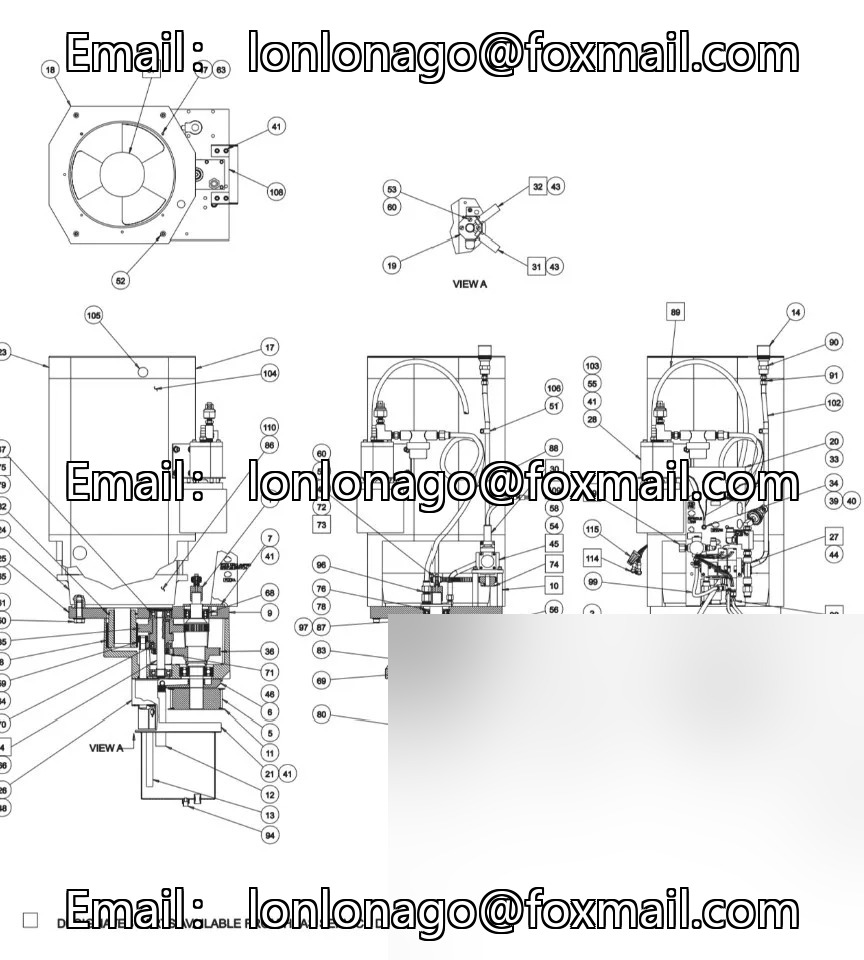
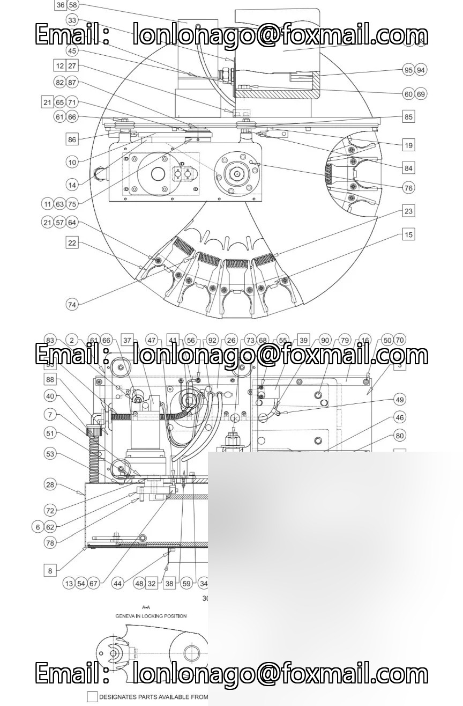
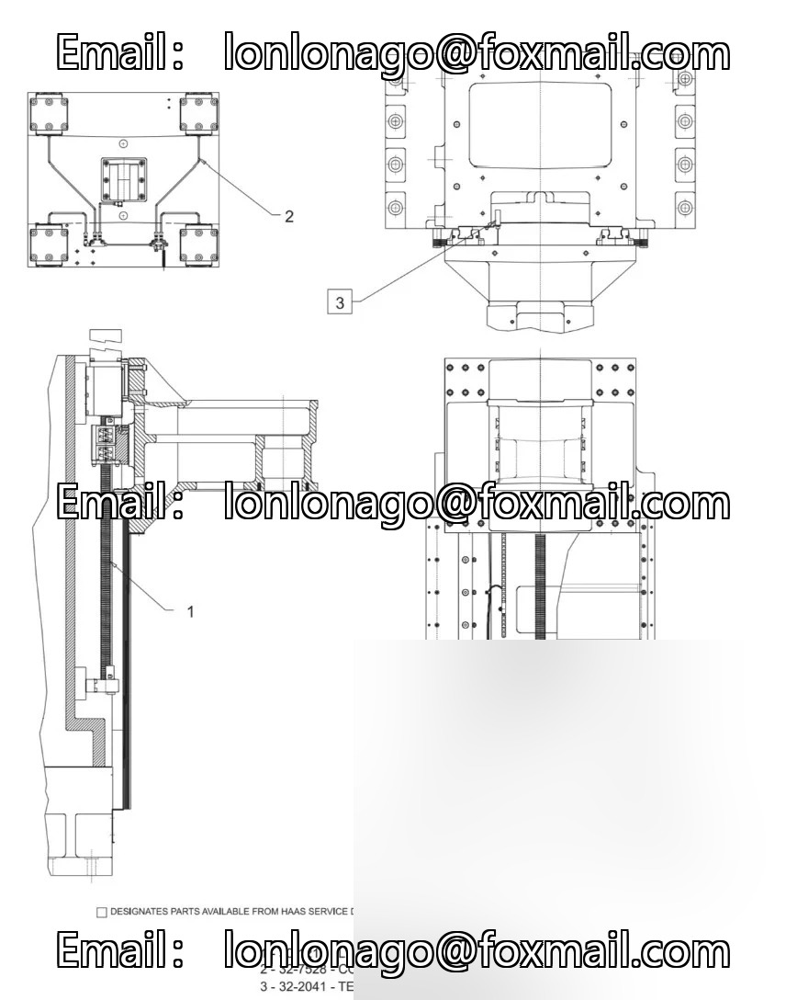
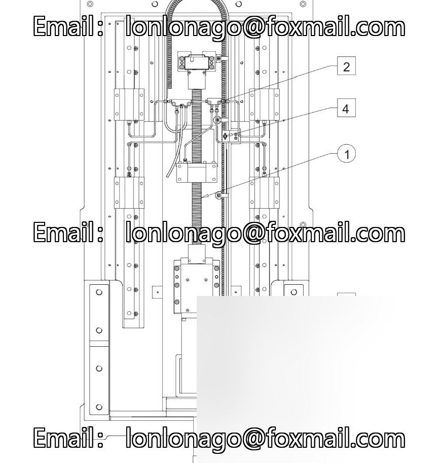
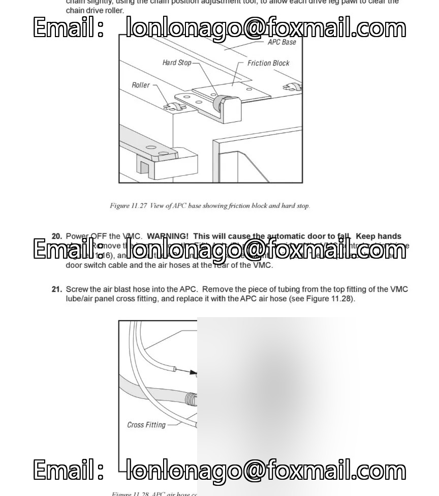
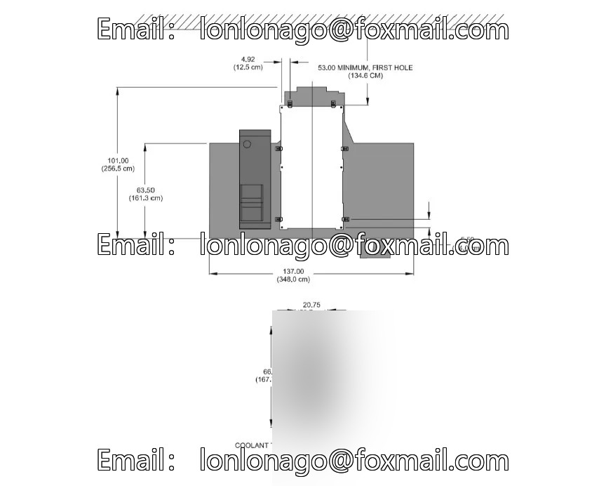

# HAS (HAAS) VF-4 vertical machining center (VMC) installation manual PDF

## Body

HAAS (Haas Automation) VF-4 vertical machining center (VMC) installation manual PDF e-book, 560 pages
HAAS VF-4 vertical CNC machining center installation manual, PDF e-book, complete content, suitable for equipment installation, maintenance, and operation reference.
The material is in , shipped via cloud drive, no price negotiation.
This equipment is the HAAS VF-4 vertical machining center, the core model in the VF series under the American Haas machine tools, and also the X axis travel capacity of 50" / 1270 mm is the largest in the standard model of this series, dedicated to handling tasks such as "long parts + multiple clamps".
39634

The manual provides detailed installation, maintenance and operation guidance for the HAAS VF-4 vertical machining center (VMC), with complete content suitable for device usage.

<!-- AI_ENRICHED -->

## Images

## Payment

Here is a pay link on Stripe ( https://buy.stripe.com/3cs8yP7sY87d0vu9AB ). Please contact me lonlonago@foxmail.com after funding $89, and I will send you a complete data files , thank you!

